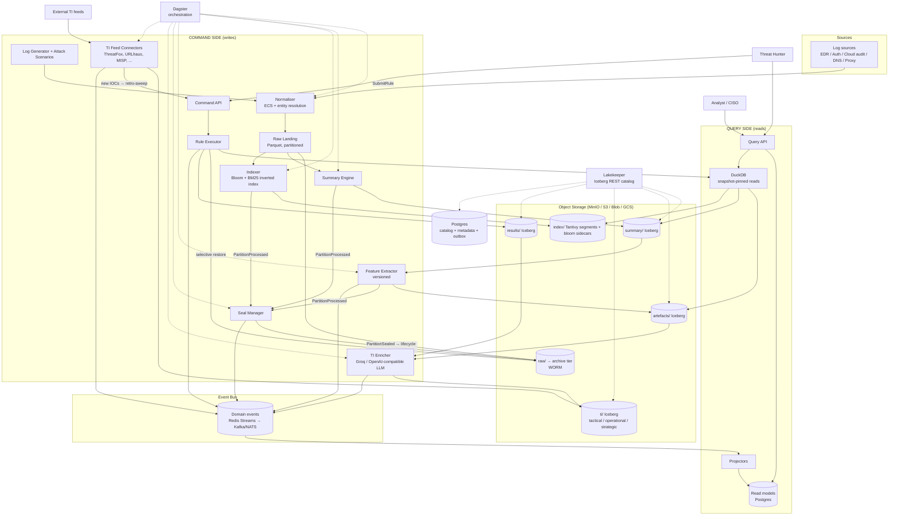
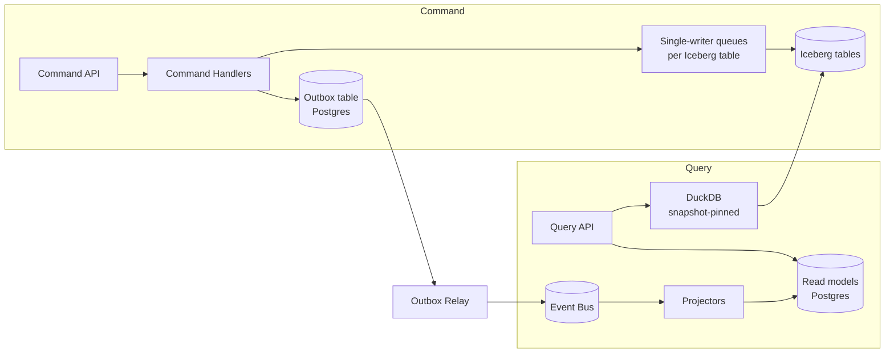
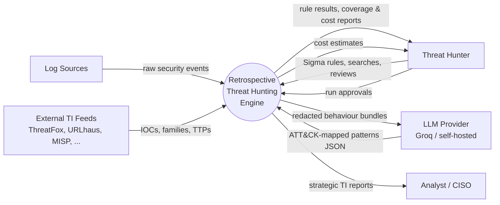
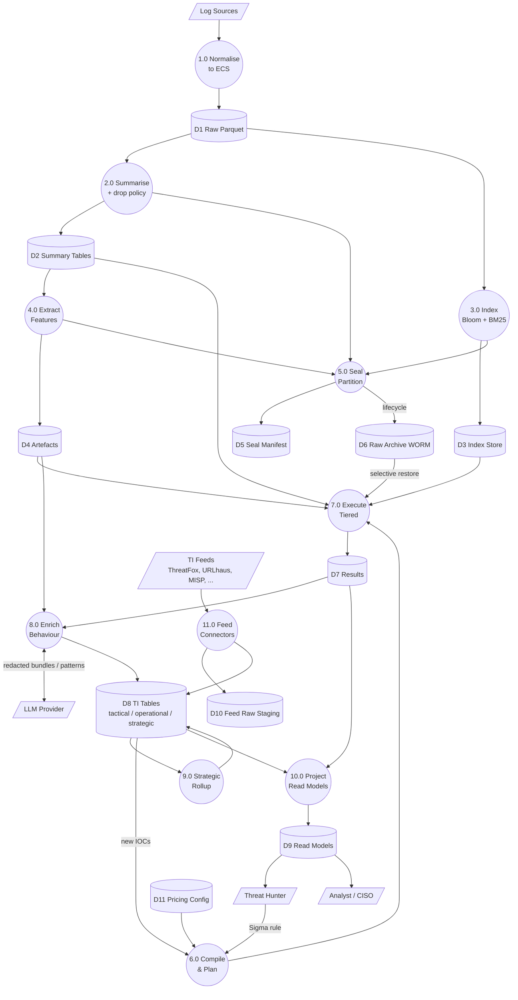
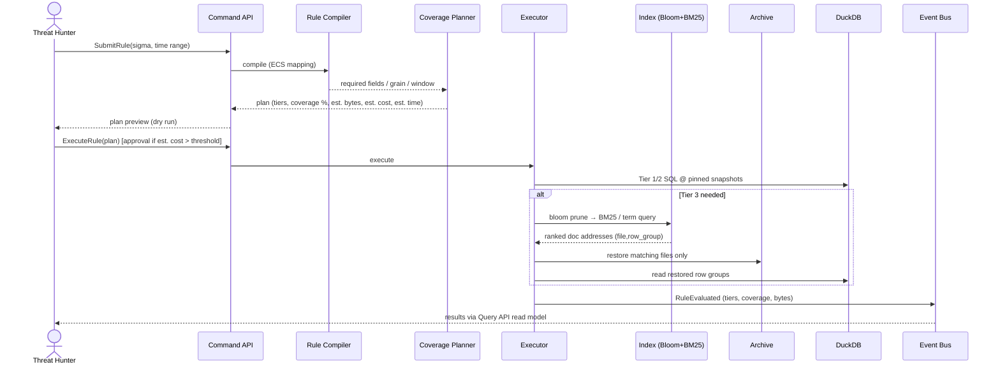

# plan.md — Artefact-based Retrospective Threat Hunting Engine

**Project:** Cost-efficient retrospective threat hunting over archived enterprise security logs
**Document status:** Implementation plan v2.1 (supersedes v2.0 and the v1.0 architecture doc)
**Date:** 2026-10-03

> **Implementation status (see README.md):** M0 to M9 implemented, plus the v3 modern-feed connectors. Measured results are in docs/evaluation.md.

---

## 0. What changed from v1.0 (decision log)

| # | Decision | v1.0 | v2.0 | Why |
|---|----------|------|------|-----|
| D1 | Positioning | "New rules never touch raw logs" | "New rules touch raw logs as little as possible, and the system **knows when they must**" | Summaries are lossy; silent false negatives are unacceptable |
| D2 | Normalisation | None | **ECS (Elastic Common Schema)** at ingest, plus entity resolution | One schema for every summary, artefact, index and rule; native Sigma→ECS mappings in pySigma |
| D3 | Raw format | CSV | **Partitioned, compressed Parquet** (zstd) | 5–10× smaller; column and row-group pruning after restore |
| D4 | Raw-data lookup | None | **Bloom-filter sidecars + BM25-ranked inverted index** (Tantivy) per sealed partition | Enables IOC sweeps and free-text hunts with targeted restore instead of full rehydration |
| D5 | Rule handling | Ad-hoc rules on artefacts | **Sigma rules → compiler → coverage planner → tiered execution** | Every result states which tier answered it and how much data was touched |
| D6 | Lifecycle | Raw moves to cold in parallel with summarisation | **Partition sealing** gates the archive move | Prevents archiving data before its summaries and indexes exist |
| D7 | Feature extraction | "One-time" | **Once per feature version**, with a feature registry and backfill | New features are inevitable; the cost is shared across all future rules |
| D8 | Candidate sets | Rules evaluated on candidates | Candidates are a **prefilter only** | Avoids inheriting blind spots of old detection logic |
| D9 | Low-value logs | Dropped | **Declarative, versioned drop/aggregate policy**; metrics are aggregated, not discarded | Metrics can be security signals (cryptomining, exfiltration volume) |
| D10 | Read/write contention | Not addressed | **CQRS**: separate command (write) and query (read) paths, an event bus, projected read models, snapshot-pinned reads | Long rule evaluations must never read half-written tables; writers must not block hunters |
| D11 | Threat intelligence | None | **LLM-assisted behavioural pattern enrichment via Groq API** feeding the tactical, operational and strategic TI tables | Builds an org-specific record of the attack types seen over time |
| D12 | Table format and catalog | Parquet + "local" catalog | **Apache Iceberg + REST catalog (Lakekeeper)**, also in the prototype | The prototype genuinely mirrors production; snapshots give lineage |
| D13 | Validation | Size comparison only | **Detection fidelity benchmarks** (recall and precision vs a raw ground truth) plus a cost model | A lossy system must prove what it loses |
| D14 | Integrity | Not addressed | **Object Lock (WORM)** on the raw archive, encryption, least-privilege buckets | Raw logs are forensic evidence; summaries are not |
| D15 | Retention | Undefined | **Minimum 15 years for every layer**, configurable upward per customer or regulation (`policies/retention.yaml`) | Longer searchable history than typical SIEM archive offerings is a competitive differentiator |
| D16 | TI model | Behaviour patterns + rollups | **Three TI tables: tactical, operational, strategic**, fed by internal enrichment **and external feeds** (ThreatFox and others) through a connector framework | Separates IOC-level, campaign-level and trend-level intelligence for different consumers |
| D17 | TI feed roadmap | "MISP / STIX in v2 or v3?" | **v2: legacy feeds** (bulk/file and older formats); **v3: newer feeds** (API/streaming, STIX 2.1/TAXII 2.1); all through one connector SDK | Ship value now; add feeds without touching the core |
| D18 | Tier 3 approval | Bytes threshold | **Estimated cost** (currency) is the approval threshold; bytes remain a hard safety cap | Hunters and managers reason in money, not bytes; restore pricing differs by tier and provider |

> **Note on Groq:** Groq is an LLM *inference* API. It does not store data. In this design it **generates and classifies** behavioural patterns. The results are stored in our own Iceberg TI tables. The LLM client targets an OpenAI-compatible endpoint, so Groq can be swapped for a self-hosted model (vLLM, Ollama) in environments where logs must not leave the org.

---

## 1. Goals and non-goals

### Goals
1. Evaluate new detection rules against **15+ years** of archived history at a fraction of full-rehydration cost.
2. Make the cost and fidelity of every evaluation **visible**: tier used, coverage %, bytes scanned, bytes restored.
3. Support the four main hunt types: aggregations, sequences and correlations, behavioural anomalies, and **IOC / free-text sweeps**.
4. Build a growing **organisational TI memory** at three levels (tactical, operational, strategic): which indicators, attack behaviours and ATT&CK techniques have been observed, when, and against what, enriched with external feeds such as ThreatFox.
5. Stay open-source and cloud-agnostic: S3-compatible storage, Iceberg, ECS, Sigma.
6. Show an **estimated cost before every expensive operation**, and record the actual cost after it.

### Non-goals (v2)
- Real-time alerting (this is a retrospective and hunting system, not a SIEM replacement).
- Automated response or SOAR actions.
- LLM output used directly as a detection verdict. LLM output is advisory and must be validated.

---

## 2. High-level architecture



---

## 3. Components

### 3.1 Log Generator and Attack Scenarios
- Generates benign baseline traffic for N users and M hosts across sources: auth, process, network, DNS, proxy, cloud audit, plus performance metrics.
- **Scenario injector** plants labelled attacks with ground truth: brute force, password spray, encoded PowerShell, LOLBins, lateral movement, privilege escalation, DNS tunnelling, exfiltration bursts, cryptomining (CPU metric spike).
- Writes ground-truth labels to `benchmarks/ground_truth/` (never visible to the engine).
- Optional ingestion of public datasets: OTRF Security-Datasets (Mordor), LANL auth.

### 3.2 Normaliser (ECS)
- Maps every source to **ECS** fields, for example `@timestamp`, `event.category`, `event.action`, `event.outcome`, `user.name`, `host.name`, `source.ip`, `destination.ip`, `process.name`, `process.command_line`, `process.parent.name`, `file.hash.sha256`, `dns.question.name`, `url.full`, `user_agent.original`, `cloud.provider`.
- Mapping definitions live in `schemas/ecs/mappings/*.yaml`, one per source and versioned.
- **Entity resolution**:
  - User alias canonicalisation (`DOMAIN\user`, `user@domain`, SID → `user.id`).
  - Time-bounded IP-to-host mapping (DHCP-style lease table).
  - Clock-skew correction per source.
- Adds `labels.ingest_partition` and `labels.ecs_mapping_version` to every row.

### 3.3 Raw Landing (Parquet)
- Layout: `raw/source=<src>/date=YYYY-MM-DD/hour=HH/part-*.parquet`
- zstd compression, row groups of about 128 MB, sorted by `@timestamp` then `host.name` for good min/max pruning.
- Each row carries a stable `event.id`. The pair (file, row_group, row_offset) is recorded by the indexer as the document address.

### 3.4 Summary Engine
- Reads one unsealed partition at a time (micro-batch), applies the **drop/aggregate policy**, and appends to Iceberg summary tables.
- Policy file: `policies/drop_policy.yaml` (versioned). Each event class gets one of three actions:
  - `keep_raw_only`: archived only, excluded from summaries
  - `aggregate`: for example metrics become hourly percentiles per host
  - `retain_high_value`: full ECS row kept in `summary.high_value_events`
- Initial summary tables:

| Table | Grain | Key columns |
|-------|-------|-------------|
| `summary.auth_hourly` | user × host × hour | success, failure, distinct src IPs, distinct logon types |
| `summary.user_daily` | user × day | distinct IPs, geos, hosts, first/last seen, privileged actions |
| `summary.process_daily` | host × process × parent × day | exec count, distinct command-line hashes, rarity score |
| `summary.network_hourly` | host × dest × port × hour | bytes in/out, conn count |
| `summary.dns_daily` | host × registered domain × day | query count, NXDOMAIN ratio, avg label entropy |
| `summary.cloud_api_daily` | principal × service × action × day | count, error count, distinct regions |
| `summary.metrics_hourly` | host × metric × hour | p50/p95/max (aggregated, not dropped) |
| `summary.high_value_events` | event | full ECS row for allow-listed event types |

### 3.5 Indexer (Bloom filters + BM25 inverted index)

Runs on every partition **before sealing**. The index lives in the *hot* tier while the raw data goes cold, which is the point of having it.

**a) Bloom-filter sidecars** (exact-membership pruning)
- One filter per (partition, field) for `source.ip`, `destination.ip`, `file.hash.*`, `dns.question.name`, `url.domain`, `user.name`, `host.name`, `process.hash.sha256`.
- Target false-positive rate 1%. Stored at `index/bloom/source=…/date=…/hour=…/<field>.bloom`.
- Stored as sidecars on purpose: blooms embedded inside Parquet would sit in the cold file and be unreachable.

**b) Inverted index with BM25 ranking** (Tantivy, via `tantivy-py`)
- One Tantivy index per sealed partition: `index/fts/source=…/date=…/hour=…/segment.tar.zst`.
- Schema:
  - **Text fields** (tokenised, BM25-scored): `process.command_line`, `url.full`, `message`, `file.path`, `user_agent.original`, `dns.question.name` (also split on dots).
  - **Keyword fields** (raw tokenizer, exact match): IPs, hashes, `user.name`, `host.name`, `event.action`.
  - **Stored fields** (doc address): `raw_file`, `row_group`, `row_offset`, `@timestamp`, `event.id`.
- Query semantics:
  - **IOC sweeps** (exact values) use boolean term queries on keyword fields. Ranking is irrelevant here; recall must be 100%.
  - **Free-text and fuzzy hunts** (for example "encoded powershell download cradle") use BM25 over text fields to rank hits, so the hunter reviews the most relevant events first and the executor restores the highest-scoring files first.
  - BM25 parameters `k1=1.2` and `b=0.75` are the defaults and are configurable per field.
- Prototype alternative: DuckDB FTS extension (`match_bm25`) over a lightweight token table. Keep it behind the same `IndexBackend` interface.
- Cross-partition search fans out over partitions selected by time range and bloom pruning, then merges top-k by BM25 score.

### 3.6 Feature Extractor (versioned)
- Feature definitions in `policies/features.yaml`: name, version, inputs (summary tables and fields), SQL or Python transform, output table.
- **Feature registry** (Postgres) records the definition hash, version, status, and the partitions it has been built for.
- Adding a feature or a new version triggers **one backfill** over existing summary tables (not raw), unless the feature declares raw-only inputs. In that case the backfill uses index-pruned restore and is logged as a cost event.
- Initial artefacts:

| Artefact table | Contents |
|----------------|----------|
| `artefacts.entity_timeline` | per user/host ordered, compacted event sequence (event class, action, peer, outcome, ts) |
| `artefacts.auth_graph_edges` | user → host → time windows, logon type, first-seen flag |
| `artefacts.process_lineage_edges` | parent → child process edges with host, ts, command-line hash |
| `artefacts.entity_profiles` | rolling 30-day baselines (hours active, usual hosts and geos, usual processes) |
| `artefacts.rarity_scores` | org-wide prevalence for processes, domains, user agents, parent-child pairs |
| `artefacts.candidates` | prefilter sets (rare + privileged + anomalous). **Never the sole source of truth.** |

### 3.7 Seal Manager and lifecycle
- A partition is **sealed** once the summary, index and every active feature version have succeeded for it, and the watermark plus grace window (default 2 h) has passed.
- Seal manifest row in Postgres: partition, row counts per stage, checksums, job versions (ECS mapping, drop policy, feature versions), Iceberg snapshot IDs.
- On seal, object tags are set on the raw files (`sealed=true`). The **tag-based lifecycle rule** then moves them to the archive tier. Object Lock (compliance mode) applies to `raw/`.
- Late data arriving after seal goes into a `late/` partition and is processed as a delta. The partition is re-sealed with an incremented seal version.

### 3.8 Rule Service (compiler, coverage planner, executor)

**Compiler**
- Input: Sigma YAML.
- pySigma pipeline: Sigma → **ECS field mapping** (pySigma's ECS processing pipelines) → custom **DuckDB SQL backend** plus a **Tantivy query backend** for Tier 3.
- Unsupported Sigma modifiers are reported at submit time, not silently ignored.

**Coverage planner**
- Extracts the rule's requirements: fields, event categories, time granularity, and any sequence or correlation window.
- Compares them with a **capability catalog** describing each table's fields, grain, retention and feature version.
- Chooses the cheapest tier that fully covers the rule:

| Tier | Source | Typical rules | Cost |
|------|--------|---------------|------|
| 1 | Artefacts | sequences, graph paths, behavioural deviations | lowest |
| 2 | Summary tables + high-value events | thresholds, aggregations, retained single-event predicates | low |
| 3 | Index → selective restore → raw Parquet | IOC sweeps, arbitrary fields, free text | bounded: only matching files and row groups |

- Partial coverage: the rule is split. Covered time ranges or predicates run at Tier 1/2, and the remainder goes to Tier 3. The report shows the coverage %.
- Dry-run mode returns the plan with an **estimated cost** (storage retrieval + requests + compute, from the cost estimator in section 13), estimated restore volume and estimated restore time.
- Approval policy (`policies/coverage_thresholds.yaml`):
  - Estimated cost ≤ `auto_approve_cost` → runs immediately.
  - Above it → requires explicit approval by the hunter; above `manager_approve_cost` → requires a second approver.
  - Bytes restored above `max_restore_bytes` → always blocked as a safety cap, regardless of cost.
- After execution, the **actual cost** is recorded next to the estimate so the estimator can be calibrated.

**Executor**
- Pins Iceberg snapshot IDs at start (see CQRS, section 4), runs the plan in DuckDB, and writes `results.rule_hits` and `results.rule_runs`.
- `results.rule_runs` columns: `rule_id`, `rule_version_hash`, `plan`, `tiers_used`, `coverage_pct`, `snapshot_ids`, `bytes_scanned`, `bytes_restored`, `files_restored`, `estimated_cost`, `actual_cost`, `cost_currency`, `pricing_version`, `approved_by`, `duration_ms`, `status`.

### 3.9 TI Enricher (Groq, behavioural patterns)

**Purpose:** turn artefacts and rule hits into **behavioural patterns** mapped to MITRE ATT&CK, then accumulate them into the three TI tables (section 3.10).

**Pipeline**
1. **Select** input bundles: clusters of related rule hits and artefact rows per entity and time window (for example one user's auth-graph edges plus process lineage plus hits over 6 h).
2. **Redact and pseudonymise** before anything leaves the boundary:
   - HMAC-keyed pseudonyms for user, host and IP (the key stays in the org).
   - Command lines are sent only if the policy allows (`policies/llm_egress.yaml`). Otherwise send command-line features instead: length, entropy, flag set, LOLBin match.
   - Raw logs are never sent; only aggregated or derived artefacts.
3. **Call the LLM** through an `LLMProvider` interface (OpenAI-compatible). Default provider is Groq; the model name comes from config and is not hardcoded. Requests use a strict JSON output schema.
4. **Validate** the output:
   - Technique and tactic IDs are checked against a local ATT&CK STIX bundle; unknown IDs are rejected.
   - Every claim must reference evidence IDs that exist in the input bundle.
   - Confidence below threshold → `status=proposed`. Otherwise `status=auto_validated`. Analyst review moves rows to `validated` or `rejected`.
5. **Persist** to `ti.operational` (append-only, via command handler) and emit `BehaviorPatternRecorded`. Indicators found in the bundle go to `ti.tactical` with `source=internal`.

- Caching: identical bundle hashes are not re-sent.
- Rate limiting and retry with backoff.
- Prompts are versioned (`prompt_version`) and recorded on every row.

### 3.10 Threat intelligence tables and feed connectors

#### a) The three TI tables (Iceberg, `ti` namespace)

Each table serves a different consumer and changes at a different speed. External feed data and internal findings land in the same tables, separated by `source`.

| Table | Level | Consumer | Grain | Updated |
|-------|-------|----------|-------|---------|
| `ti.tactical` | Tactical | detection engineers, hunters, rule service | one row per indicator per source | continuously (feed pulls, internal discoveries) |
| `ti.operational` | Operational | SOC, incident response, hunters | one row per observed behaviour or campaign activity against the org | per enrichment run and per rule run |
| `ti.strategic` | Strategic | CISO, risk, leadership | one row per period × tactic × technique × asset class × business unit × threat family | scheduled rollup (weekly, monthly, quarterly) |

**`ti.tactical`** (IOCs and detection-ready intelligence)

| Column | Notes |
|--------|-------|
| `indicator_id` | hash of (`type`, normalised `value`) |
| `type` | `ipv4`, `ipv6`, `ip:port`, `domain`, `url`, `md5`, `sha1`, `sha256`, `ja3`, `user_agent`, … |
| `value` | normalised (lower-case domains, defanged values re-fanged, URLs canonicalised) |
| `source`, `source_ref` | `threatfox`, `urlhaus`, `misp:<instance>`, `internal`, …; the source's own IOC ID |
| `threat_type` | for example `botnet_cc`, `payload_delivery`, `phishing` |
| `malware_family`, `malware_aliases[]` | normalised to a single family name where possible |
| `attack_techniques[]` | ATT&CK IDs when supplied or inferred |
| `confidence` | source confidence rescaled to 0–100 |
| `tlp` | TLP marking; controls whether the value may leave the org |
| `first_seen`, `last_seen`, `expires_at` | source timestamps; `expires_at` from per-type decay policy |
| `org_sightings`, `org_first_sighting`, `org_last_sighting` | filled by retro-sweeps and rule hits; **this is what makes the feed org-specific** |
| `status` | `active`, `expired`, `revoked`, `false_positive` |
| `connector_version`, `ingested_at` | lineage |

**`ti.operational`** (behaviours, campaigns and attack activity seen in the org)

| Column | Notes |
|--------|-------|
| `observation_id`, `pattern_id`, `pattern_version` | a pattern can have many observations |
| `title`, `narrative` | from the LLM enricher or an analyst |
| `attack_tactics[]`, `attack_techniques[]`, `kill_chain_phase` | validated against the local ATT&CK bundle |
| `threat_family`, `campaign_ref` | linked from `ti.tactical` when matched indicators carry a family or campaign |
| `matched_indicator_ids[]` | links to `ti.tactical` |
| `rule_id`, `rule_version_hash`, `rule_run_id` | if the activity came from a rule hit |
| `entity_type`, `entity_pseudonym`, `asset_class`, `business_unit` | what was targeted |
| `severity`, `confidence` | |
| `first_seen`, `last_seen`, `observed_at` | |
| `evidence_refs[]` | artefact snapshot + row IDs, rule run IDs |
| `origin` | `rule`, `llm`, `analyst`, `feed_match` |
| `llm_provider`, `llm_model`, `prompt_version` | null unless `origin=llm` |
| `status`, `reviewed_by` | `proposed`, `auto_validated`, `validated`, `rejected` |

**`ti.strategic`** (trends: which types of attack the org faces)

| Column | Notes |
|--------|-------|
| `period_type`, `period_start` | week, month, quarter, year |
| `tactic`, `technique_id` | |
| `threat_family`, `threat_type` | from linked tactical indicators |
| `asset_class`, `business_unit` | from the asset taxonomy mapping |
| `observations`, `distinct_entities`, `distinct_patterns` | |
| `feed_indicator_hits` | how many external-feed indicators were seen in the org this period |
| `delta_vs_prev_period`, `delta_vs_same_period_last_year` | trend columns; 15-year retention allows multi-year comparison |
| `top_patterns[]`, `top_families[]` | |
| `rollup_version`, `built_at` | |

- `ti.strategic` is rebuilt by a scheduled job from `ti.operational` (only `validated` and `auto_validated` rows) joined with `ti.tactical`. It answers questions such as "which ATT&CK tactics hit us most this quarter?", "is credential access trending up year on year?", "which malware families keep targeting finance?".
- Supporting (non-TI) staging table: `ti_staging.feed_raw` keeps every feed payload exactly as received, for replay and audit. It is not queried by consumers.

#### b) Feed connector framework

All feeds, internal or external, plug in through one **connector SDK** (`engine/ti/connectors/`). A connector only has to implement:

```text
class FeedConnector:
    name, version, feed_generation ("legacy" | "modern")
    fetch(since) -> raw records          # pull or bulk download
    parse(raw) -> canonical records      # into the ti.tactical / ti.operational shape
    schedule                             # cron or streaming
```

The framework handles everything else: credentials from the secret store, rate limits, retries with backoff, cursoring (`since`), deduplication by `indicator_id`, value normalisation, confidence rescaling, TLP enforcement, expiry/decay, writing through the CQRS command path, and emitting `IndicatorRecorded` events.

Feed configuration lives in `policies/ti_feeds.yaml` (enabled feeds, schedules, confidence weights, decay per indicator type, TLP rules).

**New indicators trigger retro-sweeps.** Every `IndicatorRecorded` event for an indicator not seen before queues a Tier 3 IOC sweep over the full retention window. The sweep goes through the normal planner, so it gets a cost estimate and follows the approval policy. Sweeps for one feed pull are batched into a single plan so bloom-filter pruning is shared. Hits update `org_sightings` in `ti.tactical` and create rows in `ti.operational` with `origin=feed_match`.

#### c) Feed roadmap

| Release | Generation | Feeds | Format / transport |
|---------|------------|-------|--------------------|
| **v2** | Legacy | **ThreatFox** (abuse.ch IOC database), URLhaus, MalwareBazaar, Feodo Tracker, SSL Blacklist | bulk exports (CSV/JSON) and the abuse.ch query APIs; Auth-Key from a free abuse.ch account |
| v2 | Legacy | Generic CSV / plain-text blocklists (IP, domain, URL lists) | HTTP download |
| v2 | Legacy | MISP | MISP REST API / JSON export |
| v2 | Legacy | STIX 1.x / TAXII 1.x sources still in use | XML |
| v2 | Reference | MITRE ATT&CK (enterprise STIX bundle), CISA Known Exploited Vulnerabilities | JSON download |
| **v3** | Modern | STIX 2.1 / TAXII 2.1 servers (government and ISAC sharing) | TAXII 2.1 collections |
| v3 | Modern | AlienVault OTX, AbuseIPDB, other community APIs | REST, incremental |
| v3 | Modern | Commercial feeds via customer-supplied connectors | REST / streaming |
| v3 | Modern | Push/streaming feeds (webhooks, Kafka topics) | streaming |

Feed licences and terms of use (including abuse.ch's) must be checked per deployment before redistribution or commercial use. TLP markings are enforced on export and on LLM egress.

---

## 4. CQRS design

### 4.1 Why
- **Writers** (ingest, summary, indexer, extractor, TI enricher, compaction) continuously commit to Iceberg tables and indexes.
- **Readers** (rule executions lasting minutes, hunter searches, TI dashboards) need stable, consistent data and fast responses.
- Without separation, readers see half-updated partitions, compaction races with long scans, and concurrent Iceberg commits to the same table conflict.

### 4.2 Model



### 4.3 Rules of the road
1. **All writes go through command handlers.** There are no direct writes from workers to tables. Each Iceberg table has **one writer queue**, so commits are serialised and optimistic-concurrency conflicts are rare. Retries are idempotent, keyed by `(partition, stage, job_version)`.
2. **Transactional outbox.** A command handler writes its metadata change and its event to Postgres in one transaction. A relay publishes the event to the bus. There are no lost or phantom events.
3. **Snapshot-pinned reads.** Every rule run and every query records the Iceberg snapshot IDs it read (`FOR VERSION AS OF`). A result is reproducible forever, even after compaction.
4. **Read models are projections.** Rule status, run summaries, hit counts, TI dashboards and partition health are projected into Postgres tables optimised for the API. They are eventually consistent; each response carries a `projected_at` timestamp.
5. **Maintenance is isolated.** Compaction and snapshot expiry run as commands. Snapshot expiry never removes a snapshot still referenced by an in-flight run (lease table).

### 4.4 Commands, events, queries

| Commands (write) | Events emitted | Queries (read) |
|------------------|----------------|----------------|
| `IngestBatch` | `BatchNormalised` | `GET /partitions/{id}/health` |
| `BuildSummaries(partition)` | `SummariesBuilt` | `GET /rules/{id}` |
| `BuildIndex(partition)` | `IndexBuilt` | `GET /rules/{id}/runs/{run_id}` |
| `RegisterFeature(def)` | `FeatureRegistered` | `GET /rules/{id}/runs/{run_id}/hits` |
| `ExtractFeatures(partition, feature_ver)` | `ArtefactsBuilt` | `GET /search?q=&from=&to=` (BM25) |
| `SealPartition(partition)` | `PartitionSealed` | `GET /ti/patterns?status=&technique=` |
| `SubmitRule(sigma)` | `RuleSubmitted`, `RulePlanned` | `GET /ti/observations?period=` |
| `ExecuteRule(rule, plan)` | `RuleEvaluated`, `RestoreRequested` | `GET /ti/strategic?period=quarter` |
| `EnrichBehavior(bundle)` | `BehaviorPatternRecorded` | `GET /costs?from=&to=` (estimated vs actual) |
| `ReviewPattern(id, verdict)` | `PatternReviewed` | `GET /features` |
| | | `GET /ti/strategic?period=quarter&compare=yoy` |
| `RecordIndicator(ioc)` | `IndicatorRecorded` → triggers `SubmitRule` (IOC sweep) | `GET /ti/tactical?type=&source=&sighted=true` |
| `PullFeed(connector, since)` | `FeedPulled`, `IndicatorRecorded`… | `GET /ti/feeds` (connector health, last pull) |
| `BuildStrategicRollup(period)` | `StrategicRollupBuilt` | `GET /ti/operational?technique=&family=` |
| `ApproveRun(run_id)` | `RunApproved` | `GET /rules/{id}/runs/{run_id}/estimate` |
| `ApplyRetention(layer)` | `RetentionApplied` | `GET /retention` |
| `CompactTable(table)` | `TableCompacted` | |

---

## 5. Data flow diagrams

### 5.1 DFD Level 0 (context)



### 5.2 DFD Level 1



### 5.3 Rule evaluation sequence



---

## 6. Requirements (updated PRD)

### Functional

| ID | Requirement | Priority |
|----|-------------|----------|
| FR1 | Generate realistic security logs with labelled, injectable attack scenarios | High |
| FR2 | Normalise all sources to ECS with entity resolution | High |
| FR3 | Land raw logs as partitioned zstd Parquet in object storage | High |
| FR4 | Build summary tables per partition using a versioned drop/aggregate policy | High |
| FR5 | Build bloom-filter sidecars and a BM25-ranked inverted index per partition | High |
| FR6 | Build versioned artefacts from summary tables; support backfill of new feature versions | High |
| FR7 | Seal partitions and gate the archive lifecycle on the seal; handle late data | High |
| FR8 | Accept Sigma rules; compile to DuckDB SQL and index queries via ECS mapping | High |
| FR9 | Plan rules across tiers with a coverage report and a dry-run **estimated cost**; approval policy based on estimated cost, with a bytes safety cap | High |
| FR10 | Execute Tier 3 via index-pruned selective restore only | High |
| FR11 | Store results with lineage (rule hash, snapshot IDs, tiers, bytes) | High |
| FR12 | Enforce CQRS: command handlers, outbox, event bus, projected read models, snapshot-pinned reads | High |
| FR13 | Enrich behaviour bundles via an LLM provider (Groq default) with redaction and ATT&CK validation | Medium |
| FR14 | Maintain three TI tables: `ti.tactical`, `ti.operational`, `ti.strategic` | High |
| FR15 | Build strategic rollups by period, tactic, technique, threat family, asset class and business unit, including year-on-year comparison | Medium |
| FR16 | Auto-trigger IOC retro-sweeps (with cost estimate) when new indicators are recorded | High |
| FR17 | Provide BM25 free-text search across sealed partitions | Medium |
| FR18 | Report fidelity (recall/precision vs raw ground truth) and cost vs full-rehydration baseline | High |
| FR19 | Provide a TI feed connector SDK; ship ThreatFox and other legacy feeds in v2, modern feeds in v3 | High |
| FR20 | Enforce TLP markings on TI export and LLM egress | High |
| FR21 | Retain every layer for at least 15 years; retention configurable upward per customer or regulation | High |
| FR22 | Record estimated and actual cost for every rule run, backfill and retro-sweep | High |

### Non-functional

| ID | Requirement | Priority |
|----|-------------|----------|
| NFR1 | Entire prototype runs via `docker compose up` | High |
| NFR2 | Cloud-agnostic: only the storage endpoint and catalog config change between clouds | High |
| NFR3 | Open-source stack; the LLM provider is pluggable and optional | High |
| NFR4 | No raw logs or un-pseudonymised identifiers leave the boundary (LLM egress policy) | High |
| NFR5 | Raw archive immutable (Object Lock); encryption at rest and in transit | High |
| NFR6 | Every result is reproducible from recorded snapshot IDs | High |
| NFR7 | IOC sweeps have 100% recall on indexed fields (bloom FP only adds cost, never misses) | High |
| NFR8 | Measurable resource usage and per-run cost accounting | Medium |
| NFR9 | Data written today is readable in 15+ years: open formats only, versioned schemas, periodic format/readability checks | High |
| NFR10 | Cost estimates within ±25% of actual cost after calibration | Medium |

---

## 7. Technology choices

| Layer | Prototype | Production |
|-------|-----------|------------|
| Object storage | MinIO (Object Lock enabled) | S3 / Azure Blob / GCS |
| Raw format | Parquet (zstd) | Parquet (zstd) |
| Table format | Apache Iceberg (PyIceberg writes) | Apache Iceberg |
| Catalog | Lakekeeper (REST) + Postgres | Lakekeeper / Polaris / Glue / Unity |
| Schema | ECS | ECS |
| Normalise / summarise | Python + Polars / DuckDB | Spark or Flink |
| Index | tantivy-py + bloom sidecars (`rbloom`) | Tantivy service / Rust indexer on Spark executors |
| Feature extraction | Python + DuckDB | Spark / Ray |
| Rules | pySigma + custom DuckDB backend | same; Trino/Spark backend for scale |
| Query engine | DuckDB (iceberg extension) | DuckDB / Trino / Spark / Athena |
| Event bus | Redis Streams | Kafka or NATS JetStream |
| Metadata / outbox / read models | Postgres | Postgres (managed) |
| Orchestration | Dagster (partitioned assets) | Dagster |
| LLM | Groq API via OpenAI-compatible client | Groq or self-hosted vLLM |
| TI feeds | Connector SDK (Python) + ThreatFox and abuse.ch connectors | same SDK; v3 adds TAXII 2.1 (`taxii2-client`, `stix2`) and REST connectors |
| Cost estimator | `policies/pricing.yaml` + Python estimator | same, with prices per provider/region and calibration from actual billing |
| APIs | FastAPI (command-api, query-api) | same, containerised |

---

## 8. Folder structures

### 8.1 Prototype

```text
threat-hunting-artefact-engine/
├── docker-compose.yml
├── .env.example                      # MinIO, Postgres, Groq key, abuse.ch Auth-Key, HMAC key ref
├── Makefile                          # up, seed, demo, bench, down
├── README.md
├── plan.md
│
├── policies/
│   ├── drop_policy.yaml
│   ├── features.yaml
│   ├── llm_egress.yaml
│   ├── coverage_thresholds.yaml      # cost-based approval limits + bytes cap
│   ├── retention.yaml                # ≥ 15 years per layer
│   ├── pricing.yaml                  # storage/retrieval/compute unit prices
│   └── ti_feeds.yaml                 # enabled feeds, schedules, decay, TLP
│
├── schemas/
│   ├── ecs/
│   │   ├── fields.yaml               # ECS subset in use
│   │   └── mappings/                 # one file per source
│   ├── iceberg/                      # table DDL for summary/artefacts/ti/results
│   └── llm/pattern_output.schema.json
│
├── rules/
│   ├── sigma/                        # benchmark rule corpus
│   └── pipelines/ecs_custom.yaml     # pySigma processing pipeline
│
├── scenarios/                        # attack injection definitions
├── data/attack/enterprise-attack.json  # local ATT&CK STIX bundle
│
├── engine/                           # single Python package, one image
│   ├── pyproject.toml
│   ├── common/
│   │   ├── storage.py                # S3-compatible client
│   │   ├── catalog.py                # PyIceberg / Lakekeeper
│   │   ├── events.py                 # event types + bus client
│   │   ├── outbox.py
│   │   └── pseudonymise.py
│   ├── generator/
│   ├── normaliser/
│   ├── summary/
│   ├── indexer/
│   │   ├── bloom.py
│   │   ├── fts_tantivy.py            # BM25 inverted index
│   │   └── backend.py                # IndexBackend interface
│   ├── features/
│   ├── seal/
│   ├── rules/
│   │   ├── compiler.py               # pySigma → DuckDB SQL / Tantivy
│   │   ├── planner.py                # coverage + tier selection
│   │   └── executor.py
│   ├── ti/
│   │   ├── bundler.py
│   │   ├── llm_provider.py           # OpenAI-compatible; Groq default
│   │   ├── validator.py              # ATT&CK + evidence checks
│   │   ├── rollups.py                # builds ti.strategic
│   │   ├── tables.py                 # ti.tactical / operational / strategic writers
│   │   └── connectors/
│   │       ├── sdk.py                # FeedConnector base, normalise, dedupe, TLP
│   │       ├── threatfox.py
│   │       ├── urlhaus.py
│   │       ├── malwarebazaar.py
│   │       ├── feodo.py
│   │       ├── csv_blocklist.py
│   │       ├── misp.py
│   │       └── stix1_taxii1.py
│   ├── cost/
│   │   ├── estimator.py              # restore + scan + compute estimates
│   │   └── calibrate.py              # compares estimate vs actual
│   ├── retention/
│   │   └── enforcer.py               # applies retention.yaml, readability checks
│   ├── cqrs/
│   │   ├── commands.py
│   │   ├── handlers.py
│   │   ├── writer_queue.py
│   │   └── projectors.py
│   └── api/
│       ├── command_api.py
│       └── query_api.py
│
├── orchestration/dagster/            # assets, sensors, schedules
├── benchmarks/
│   ├── ground_truth/
│   ├── fidelity.py                   # recall/precision per rule
│   └── cost.py                       # vs full-rehydration baseline
├── tests/
│   ├── unit/
│   ├── integration/
│   └── e2e/
└── docs/
    ├── architecture.md
    ├── prd.md
    └── demo-script.md
```

### 8.2 Production

```text
threat-hunting-platform/
├── infra/
│   ├── terraform/
│   │   ├── modules/{storage,catalog,compute,network,kms}/
│   │   └── envs/{aws,azure,gcp}/
│   └── helm/                         # charts per service
├── services/
│   ├── normaliser/                   # Flink/Spark job
│   ├── summary-engine/               # Spark job
│   ├── indexer/                      # Rust (Tantivy) + Spark driver
│   ├── feature-extractor/            # Spark / Ray
│   ├── seal-manager/
│   ├── rule-service/                 # compiler, planner, executor
│   ├── ti-enricher/
│   ├── ti-connectors/                # one deployable per feed generation (legacy / modern)
│   ├── cost-estimator/
│   ├── retention-enforcer/
│   ├── projector/
│   ├── command-api/
│   └── query-api/
├── libs/
│   ├── python-common/
│   └── schemas/                      # ECS, Iceberg DDL, event contracts (versioned)
├── policies/                         # same as prototype, environment overlays
├── rules/                            # Sigma repo + CI validation
├── orchestration/dagster/
├── observability/                    # dashboards, alerts, cost reports
├── benchmarks/
├── tests/
└── docs/
```

---

## 9. Docker Compose services (prototype)

| Service | Image | Notes |
|---------|-------|-------|
| `minio` | minio/minio | Object Lock enabled; versioning on `raw` |
| `minio-init` | minio/mc | creates buckets, lifecycle rules, Object Lock |
| `postgres` | postgres | catalog, metadata, outbox, read models (separate schemas) |
| `lakekeeper` | lakekeeper | Iceberg REST catalog |
| `redis` | redis | event bus (Streams) |
| `dagster-web`, `dagster-daemon` | engine image | orchestration |
| `command-api` | engine image | `engine.api.command_api` |
| `query-api` | engine image | `engine.api.query_api` |
| `writer` | engine image | single-writer queues |
| `outbox-relay` | engine image | |
| `projector` | engine image | |
| `ti-enricher` | engine image | disabled unless `LLM_PROVIDER` is set |
| `ti-connectors` | engine image | runs enabled feeds from `ti_feeds.yaml`; needs `THREATFOX_AUTH_KEY` |

All workers share one `engine` image with different entrypoints, which keeps the prototype light.

---

## 10. Milestones

| # | Milestone | Deliverables | Exit criteria |
|---|-----------|--------------|---------------|
| M0 | Foundations | Compose stack, buckets, catalog, Postgres schemas, event contracts, CQRS skeleton (command API, writer queue, outbox, relay, projector, query API) | `make up` healthy; a no-op command produces an event and a projected read-model row |
| M1 | Data in | Generator + scenarios, ECS normaliser, entity resolution, raw Parquet landing | 7 days × 5 sources generated; 100% of rows ECS-valid; ground truth stored |
| M2 | Summaries | Drop policy, summary tables, metrics aggregation | Summary-to-raw size ratio reported; policy version on every row |
| M3 | Index | Bloom sidecars, Tantivy BM25 index, `IndexBackend`, `/search` | Planted IOCs found with 100% recall; BM25 top-10 contains planted free-text attacks |
| M4 | Artefacts and sealing | Feature registry, initial artefacts, backfill, seal manager, tag-based lifecycle, late-data path | No raw partition reaches archive unsealed (test enforced); backfill of a new feature version touches no raw data |
| M5 | Rules and cost | pySigma compiler (ECS), coverage planner, cost estimator + `pricing.yaml`, dry run, cost-based approval, tiered executor, lineage | Benchmark corpus runs; each run reports tiers, coverage %, bytes, estimated and actual cost; reruns at pinned snapshots are identical |
| M6 | TI (internal) | Bundler, redaction, Groq provider, validator, `ti.tactical` / `ti.operational` / `ti.strategic`, rollups | No identifiers leak in egress logs; invalid ATT&CK IDs rejected; `ti.strategic` shows planted scenario tactics |
| M7 | TI feeds v2 (legacy) | Connector SDK; ThreatFox, URLhaus, MalwareBazaar, Feodo, CSV blocklists, MISP, STIX 1.x; ATT&CK + CISA KEV reference; IOC → retro-sweep loop | A ThreatFox IOC planted in generated logs is ingested, swept, and appears in `ti.tactical.org_sightings`, `ti.operational` (`origin=feed_match`) and `ti.strategic` |
| M8 | Retention | `retention.yaml`, Object Lock 15y, retention enforcer, readability checks, multi-year synthetic history | Simulated 15-year partition layout queryable; year-on-year strategic comparison works |
| M9 | Evaluation | Fidelity + cost benchmarks, estimator calibration, demo script, docs | Report: tier-hit distribution, recall/precision per rule, bytes restored vs full rehydration, estimate accuracy, LLM mapping accuracy |
| v3 | TI feeds (modern) | TAXII 2.1 / STIX 2.1, OTX, AbuseIPDB, commercial and streaming connectors | New connector added without changes outside `connectors/` |

---

## 11. Evaluation metrics

| Metric | Definition | Target (prototype) |
|--------|------------|--------------------|
| Tier-hit rate | % of benchmark rules answered fully at Tier 1/2 | ≥ 70% |
| Detection recall | hits on artefacts/summaries ÷ hits on raw ground truth, per rule | ≥ 0.95 for rules planned at Tier 1/2 |
| Precision | true positives ÷ hits | report; no regression vs raw |
| Restore ratio | bytes restored in Tier 3 ÷ bytes a full rehydration would restore | ≤ 5% for IOC sweeps |
| Storage ratio | (summary + artefacts + index) ÷ raw | report |
| Latency | p50/p95 rule run time per tier | report |
| LLM mapping accuracy | correct ATT&CK technique ÷ planted scenarios | ≥ 0.8 after validation |
| Cost estimate accuracy | \|estimated − actual\| ÷ actual, per run | within ±25% after calibration |
| Feed-to-sighting latency | time from a feed publishing an IOC to its retro-sweep result | report |
| Retro-sweep cost per indicator | actual cost ÷ indicators swept (batched) | report |
| Cost model | `Baseline = N × C_full` vs `Ours = C_extract + Σ C_tier·n_tier + n_T3 × C_restore` | report break-even N |

---

## 12. Retention (15-year minimum)

### 12.1 Policy

Every layer is kept for **at least 15 years**. Customers or regulators can raise this per tenant, per source or per layer; nothing can lower it below 15 years without a policy change recorded in the decision log.

```yaml
# policies/retention.yaml
version: 1
minimum_years: 15
layers:
  raw:            { years: 15, object_lock: compliance }
  summary:        { years: 15 }
  artefacts:      { years: 15 }
  index_keyword:  { years: 15 }        # bloom sidecars + keyword postings
  index_text:     { years: 15 }        # BM25 segments
  results:        { years: 15 }
  ti_tactical:    { years: 15 }        # expired indicators kept, status=expired
  ti_operational: { years: 15 }
  ti_strategic:   { years: 15 }
  feed_raw:       { years: 15 }
overrides: []                          # e.g. { tenant: x, layer: raw, years: 20 }
```

### 12.2 Storage tiering inside the retention window

Retention says how long data exists; tiering says where it sits. Both are driven by the seal date.

| Layer | 0–90 days | 90 days – 1 year | 1 – 15+ years |
|-------|-----------|------------------|---------------|
| Raw Parquet | hot (standard) | instant-retrieval archive | deep archive (WORM) |
| Summaries, artefacts | hot | hot | infrequent-access |
| Keyword index + bloom sidecars | hot | hot | infrequent-access (must stay directly readable; this is what keeps Tier 3 cheap) |
| BM25 text index | hot | infrequent-access | infrequent-access |
| TI tables, results | hot | hot | infrequent-access |

- Raw files are compacted into large objects (≥ 128 MB) **before** archiving, because deep-archive tiers charge per-object overhead and minimum storage durations.
- Lifecycle transitions are tag-based and only apply to sealed partitions (section 3.7).

### 12.3 Keeping data readable for 15+ years

- **Open formats only:** Parquet, Iceberg, JSON, plain YAML. No proprietary encodings.
- **Schema versioning:** every row carries `labels.ecs_mapping_version`; a schema registry keeps every ECS mapping version so old data can be read with the mapping it was written with.
- **Index durability:** Tantivy's on-disk format can change between major versions. The keyword postings (term → doc address) are therefore also exported as a Parquet table, `index.keyword_postings`, which stays readable regardless of the Tantivy version. BM25 segments record the Tantivy version and are rebuilt when a format upgrade is required.
- **Iceberg lineage over 15 years:** ordinary snapshots expire after 90 days; snapshots referenced by rule results are kept with **Iceberg tags** for the full retention period, so results stay reproducible.
- **Annual readability drill:** a scheduled job reads a random sample of partitions from every retained year (including a real archive restore) and fails loudly if anything cannot be read.
- **Key management:** envelope encryption with keys whose lifetime exceeds the data's; key rotation re-wraps data keys without rewriting data.
- **Legal hold** on top of retention for incident or litigation scope.

### 12.4 Retention and data-protection law

Compliance-mode WORM means raw data cannot be deleted for 15 years, which can conflict with erasure rights under data-protection laws (for example GDPR or India's DPDP Act). Mitigations: identifiers are pseudonymised in every derived layer and in TI tables; raw retention must be justified by a documented legal or security obligation; legal sign-off is required per deployment (see section 15).

---

## 13. Cost estimation

### 13.1 How estimates are produced

All prices live in `policies/pricing.yaml` per provider and region (S3, Azure Blob, GCS, or simulated prices for MinIO). The estimator never hardcodes prices.

For any planned operation (rule run, retro-sweep, feature backfill):

```text
estimated_cost =
    Σ restored_GB(tier)  × retrieval_price(tier, speed)
  + Σ restore_requests   × request_price(tier)
  + Σ scanned_GB         × query_price(engine)           # 0 for self-hosted DuckDB
  + compute_hours        × compute_price(instance)
  + temp_storage_GB × days × hot_storage_price           # restored copies
  + llm_tokens           × llm_price                     # only for enrichment
```

- `restored_GB` comes from bloom pruning and BM25/term index hits, read from Parquet footer metadata stored alongside the index (no archive access needed to estimate).
- `compute_hours` comes from a per-tier throughput model calibrated from past runs.
- Every run stores `estimated_cost`, `actual_cost` and `pricing_version`; `engine/cost/calibrate.py` adjusts the throughput model when estimates drift.

### 13.2 Approval thresholds (example defaults)

```yaml
# policies/coverage_thresholds.yaml
currency: USD                 # or INR, EUR …
auto_approve_cost: 25
manager_approve_cost: 500     # needs a second approver above this
max_restore_bytes: 50TB       # hard safety cap, never overridden by approval
daily_budget: 2000            # retro-sweeps from feeds queue once this is reached
```

### 13.3 Worked example (illustrative)

Assumptions, to be replaced with the customer's real volumes and current prices in `pricing.yaml`:

- 1 TB/day of raw logs, compressed to about 200 GB/day as Parquet (5×) → about **73 TB per year**, **about 1.1 PB over 15 years**.
- Derived layers (summaries, artefacts, indexes) about 15% of Parquet volume → about 11 TB per year.
- Unit prices modelled on AWS us-east-1 list prices (verify before use): standard $0.023/GB-month, infrequent-access $0.0125/GB-month, instant-retrieval archive $0.004/GB-month, deep archive $0.00099/GB-month; deep-archive standard retrieval about $0.02/GB.

**Storage, steady state at year 15**

| Item | Volume | Monthly cost |
|------|--------|-------------|
| Raw, most recent year (instant-retrieval archive) | 73 TB | ≈ $290 |
| Raw, years 2–15 (deep archive) | 1,022 TB | ≈ $1,010 |
| Derived layers, 15 years (infrequent-access) | 165 TB | ≈ $2,060 |
| **Total** | | **≈ $3,360/month (≈ $40k/year)** |
| *Comparison: 15 years of raw Parquet on standard storage* | *1,095 TB* | *≈ $25,200/month* |

**Per-hunt cost, searching 5 years of history (≈ 365 TB of raw Parquet)**

| Approach | Data restored | Estimated retrieval cost |
|----------|---------------|--------------------------|
| Full rehydration from deep archive (baseline) | 365 TB | ≈ $7,300 + compute, ~12 h+ wait |
| Tier 3, index-pruned (5% restore ratio target) | ≈ 18 TB | ≈ $365 + compute |
| Tier 3, single IOC with bloom pruning (≈ 0.5%) | ≈ 1.8 TB | ≈ $37 + compute |
| Tier 1/2 (artefacts, summaries) | 0 | compute only, typically cents |

With these assumptions, a team that runs 50 five-year hunts a year would spend about $365k/year on full rehydration. On this design the same hunts cost close to nothing when answered at Tier 1/2, and at most about $18k if every one needed an index-pruned Tier 3 restore, before compute. The real benchmark (M9) replaces these figures with measured ones.

---

## 14. Risks and mitigations

| Risk | Mitigation |
|------|------------|
| Silent false negatives from lossy layers | Coverage planner never answers a rule from a layer that lacks its fields; fidelity benchmarks in CI |
| Sensitive data sent to an external LLM | Egress policy, HMAC pseudonymisation, derived features only, egress audit log, self-hosted provider option |
| LLM hallucinated TTPs | ATT&CK ID validation, evidence-reference checks, confidence threshold, analyst review status; rollups use validated rows only |
| Iceberg commit conflicts and small files | Single-writer queue per table; scheduled compaction command; snapshot leases |
| Eventual consistency confuses users | `projected_at` on every read model; rule results always link to pinned snapshots |
| Index size growth | Per-partition segments, field allow-list, tiered index retention (keyword fields kept longer than text fields) |
| Entity resolution errors corrupt timelines | Resolution versioned and recorded; resolution-confidence column; rebuild via feature backfill |
| Unsupported Sigma constructs | Rejected at submit with an explicit report; never silently dropped |
| Archive restore latency (deep-archive tiers) | Planner exposes estimated restore time; most recent year kept in instant-retrieval tier |
| Feed false positives (CDNs, shared hosting, sinkholes) | Warninglists (MISP-style) suppress known-benign values; per-source confidence weights; indicator decay and expiry |
| Retro-sweep cost storms after a large feed pull | Sweeps batched per pull; daily budget cap; normal cost-based approval |
| Feed licensing and TLP violations | Per-feed licence notes in `ti_feeds.yaml`; TLP enforced on export and LLM egress |
| Data unreadable after 15 years (format or tool drift) | Open formats, schema registry, Parquet copy of keyword postings, annual readability drill |
| WORM retention vs erasure rights | Pseudonymisation in derived layers; documented legal basis; legal sign-off per deployment |
| Cloud price changes break estimates | Prices only in `pricing.yaml` with a version; estimates recorded with `pricing_version`; calibration against actual billing |

---

## 15. Decisions and open questions

### Resolved (v2.1)

| # | Question | Decision |
|---|----------|----------|
| 1 | Retention per layer | **At least 15 years for every layer**, configurable upward per customer or regulation (section 12) |
| 4 | External TI feeds | **v2: legacy feeds**, including ThreatFox and the other abuse.ch feeds, CSV blocklists, MISP and STIX 1.x. **v3: modern feeds** (TAXII 2.1, community and commercial APIs, streaming). All via the connector SDK (section 3.10) |
| 5 | Tier 3 approval threshold | **Estimated cost**, with bytes as a hard safety cap (sections 3.8 and 13) |

### Still open

1. Which business-unit and asset-class taxonomy feeds `ti.strategic`? (Needs a CMDB or a static mapping file.)
2. Analyst review workflow for TI patterns: inside the query API, or an external case tool?
3. Default currency and approval amounts for `coverage_thresholds.yaml`.
4. Which commercial feeds to prioritise for v3 connectors.
5. Legal sign-off on 15-year WORM retention vs erasure obligations, per deployment region.
